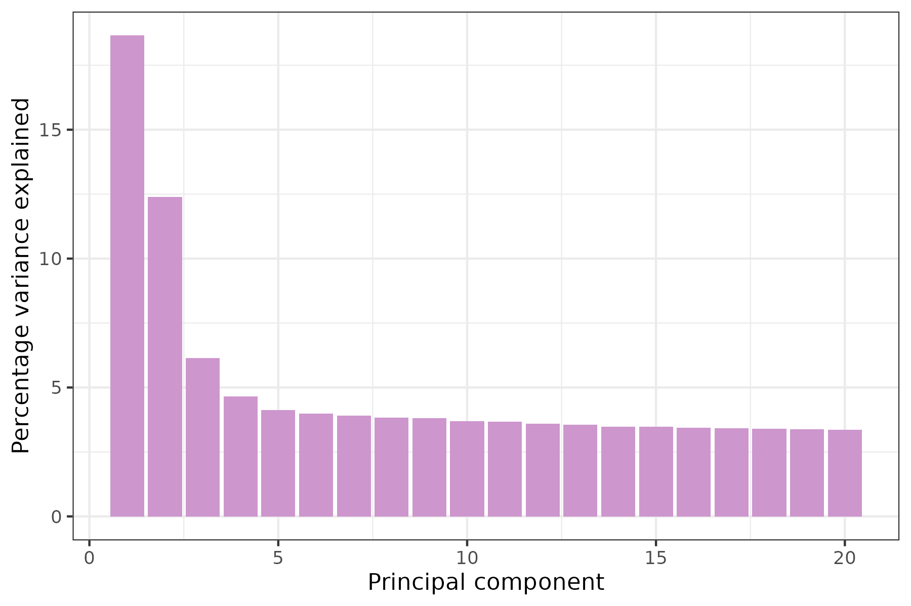
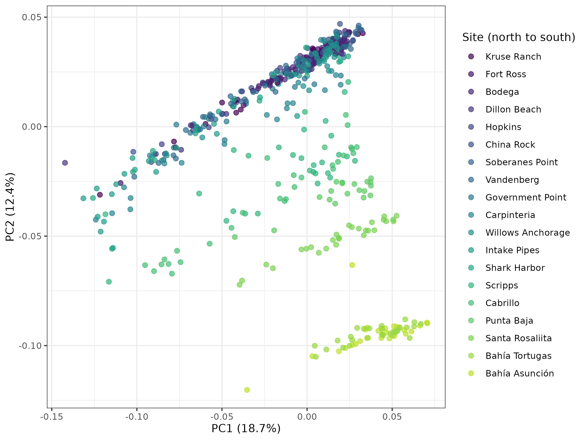
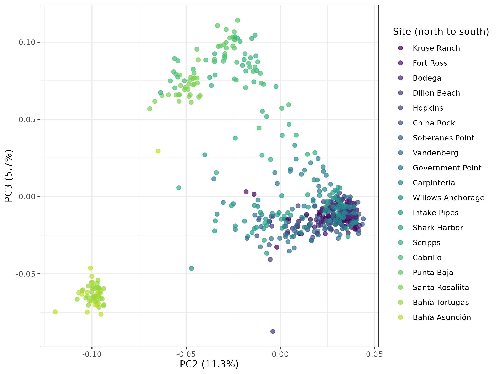
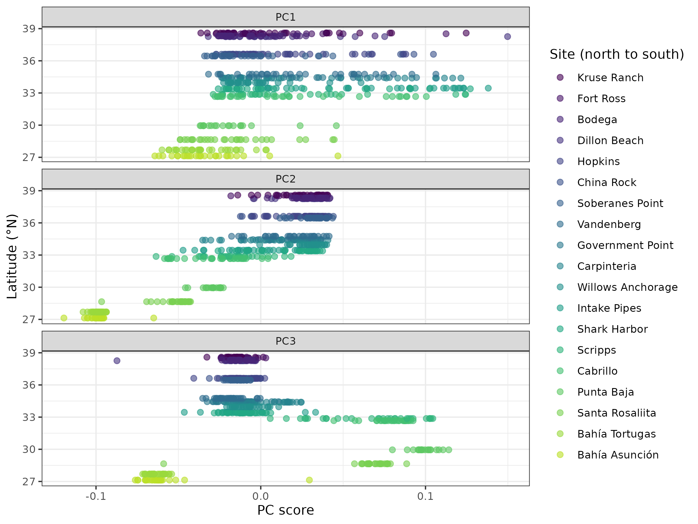
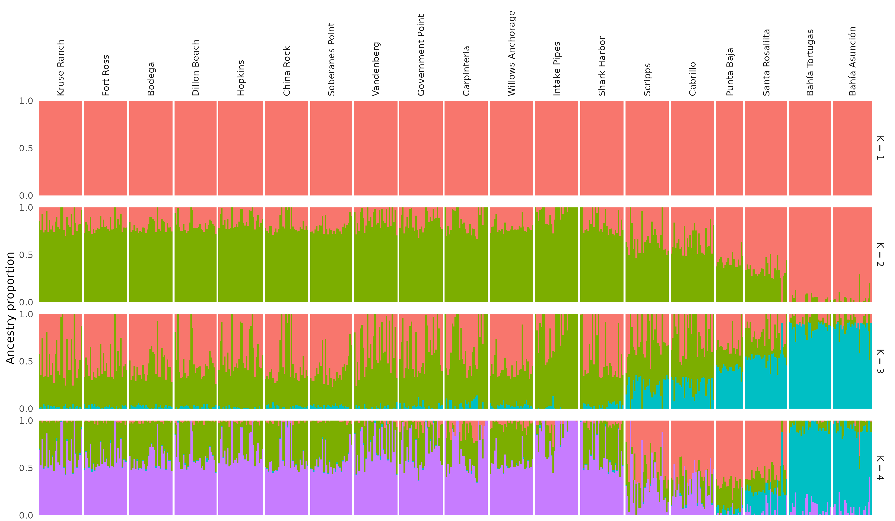

# Homework 2: Question 3

Anna Smith, 11/8/26

------------------------------------------------------------------------

**Question:** Rerun PC and ADMIXTURE on the data with a less strict LD threshold; what is the population structure now? How many PC components do you think you should use, and how much variation do they explain? Is it supported by ADMIXTURE? Is the population structure supported by any other metrics (e.g., genetic diversity)?

**Script:** Homework_2.R in myscripts in population_genomics

**Data**: Homework_2 in mydata

**Code:** Setup the Data with Plink

```{r}
#### IN TERMINAL/BASH ####'

## REMEMBER: you need to run this every time you open a VACC session as it does not save this variable ##

DATA_DIR=~/eco_genomics_2026/population_genomics/mydata
VCF=$DATA_DIR/Lottia_gigantea_pl_flt3.renamed.vcf.gz

# check the variable holds what you expect, and that the file is really there
echo $VCF
ls -lh $VCF

cd $DATA_DIR
pwd ##check you are in the right place

# within Population_Structure in mydata, I have all of PCA, admixture, and metadata files stored #

#### Pruning with Plink ####
# Load plink and check the version. We need PLINK 1.9: PLINK 2.0 (plink2) changed a lot of the syntax, and not all of the commands below will work with it.
module load plink
plink --version   # PLINK v1.9.0-b.7.7 64-bit (22 Oct 2024)

# created for human genomics, so our data is lacking in comparison, therefore we need to format our data in a way that plink will be able to read
#The \ at the end of a line tells bash that the command continues on the next line. It must be the very last character on the line, with no spaces after it.

#Let’s run through what we asked plink to do. plink --help lists every option, and plink --help indep-pairwise gives the manual for just one.

## Changing the LD Threshold here to be less strict... 0.5 instead of 0.2... will result in less SNPs getting discarded during pruning 
plink --vcf $VCF --double-id --allow-extra-chr \
    --set-missing-var-ids @:# \
    --indep-pairwise 50 10 0.5 \ #changed the last value to 0.5 here to reflect new threshold
    --out Lg_LD_0.5

# how many SNPs did we keep and remove in LD = 0.2 compared to LD = 0.5?
wc -l Lg_LD_0.5.prune.in Lg_LD_0.5.prune.out
  # 549850 Lg_LD_0.2.prune.in
  # 1271900 Lg_LD_0.2.prune.out
  # 1821750 total
# compare that to:
  # 983923 Lg_LD_0.5.prune.in
  # 837827 Lg_LD_0.5.prune.out
  # 1821750 total

#### Plink output Files ####
# File                       Contents
# Lg_LD_0.5.prune.in      -      IDs of the SNPs to keep (LD pruned data)
# Lg_LD_0.5.prune.out     -      IDs of the SNPs to remove (SNPs in LD > 0.5)
# Lg_LD_0.5.log         -      Everything plink printed to the screen. Check here how many SNPs and samples were read in
# Lg_LD_0.5.nosex         -      The samples with no sex information, which is all of ours. plink expects sexes for human data, so you can ignore this file
```

**Code:** Prepping to run PCA

```{r}
#### DONE IN TERMINAL/BASH ####

#### RUNNING PCA ####
# Now we run the PCA on just the SNPs we kept:
plink --vcf $VCF --double-id --allow-extra-chr --set-missing-var-ids @:# \
    --extract Lg_LD_0.5.prune.in \
    --make-bed --pca --out Lg_LD_0.5
## Output Files ##
# Lg_LD_0.5.eigenvec == The PCA results: one row per individual, with its family ID, individual ID, then its score on PC1 to PC20
# Lg_LD_0.5.eigenval    ==  The eigenvalue of each PC: how much of the variation it captures
# Lg_LD_0.5.bed ==  The genotypes of the pruned SNPs, stored in a compressed binary format. You can’t read it as text, and it isn’t the same thing as a BED file of genome intervals!
# Lg_LD_0.5.bim  ==  One row per SNP: scaffold, SNP ID, genetic distance (0 = unknown), position, and the two alleles
# Lg_LD_0.5.fam  ==  One row per individual: family ID, individual ID, father, mother, sex and phenotype (0 or -9 = unknown)

# Each row of the .eigenvec file holds an individual’s eigenvector values, i.e. its coordinates on each PC, which are what we plot. The eigenvalues tell us how much of the variation each PC captures. Take a quick look:
# first 3 individuals, first 4 PCs (cut -f keeps only the columns we ask for)
head -n 3 Lg_LD_0.5.eigenvec | cut -d " " -f 1-6
cat Lg_LD_0.5.eigenval

```

**Code**: PCA in R (explained changes to OG code)

```{r}
## All code run in Homework_2.R in myscripts of population_genomics ##

# whenever the code refers to the data, ensure that it has the 0.5 version not the 0.2 version to reflect less strict LD threshold

# added color to the bars :)
```

**Figure 1: Scree plot - How much variation does each PC account for?**



**Code:** Running the PCAs (explain changes to OG code)

```{r}
# made new folder in mydata called Homework_2 to store all of the LD threshold 0.5 data as well as sample metadata

# all other PCA code stayed the same, just ran it from new LD threshold dataset
```

**Figure 2:** PC1 vs PC2



**Code:** PC2 vs PC3

```{r}
# same code used to generate above pca, just had to change this:
  # axis labels with the % variance explained, e.g. "PC1 (4.2%)"
  pc2_lab <- paste0("PC1 (", round(pve$pve[2], 1), "%)") #changed number in brackets   to reflect pc2 not pc1
  pc3_lab <- paste0("PC2 (", round(pve$pve[3], 1), "%)") #changed number in brackets   to reflect pc3 not pc2
# changed the rest of the code that refered to each PC to refelct 2 and 3 not 1 and 2
```

**Figure 3**: PC2 vs PC3



-   This PCA is quite interesting, because despite PC3 only describing roughly 6% of variation, it strongly supports the isolation of the two southernmost populations from the rest of the data, which supports population structure evaluations from the first PCA.

-   We also still see some separation between northernmost and more southern populations along a rough latitudinal gradient, which was also seen with a more strict threshold similarly, meaning this is a strong aspect of population structure.

**Code**: Is there still a pattern with latitude?

```{r}
# just added PC3 wherever other PCs were referenced in the code

```

**Figure 4:** PCs by latitude plot



-   still very similar to higher threshold, distinct separation of populations by latitude even in PC3!

**Code:** Admixture (Ran top bit as batch job under Homework_batch.sh in myscripts)

```{r}
#### Prepping Data ####
# keep a copy of the original .bim file (only run this line once! see below)
cp Lg_LD_0.5.bim Lg_LD_0.5.bim.orig

# read the original, replace column 1 (the chromosome) with 0, and write the new .bim
# OFS="\t" keeps the columns tab-separated
awk 'BEGIN{OFS="\t"} {$1="0"; print}' Lg_LD_0.5.bim.orig > Lg_LD_0.5.bim

# compare before and after
head -n 3 Lg_LD_0.5.bim.orig
head -n 3 Lg_LD_0.5.bim
#### Running Admixture ####
module load admixture

INPUT="Lg_LD_0.5.bed"
K_MIN=1
K_MAX=10
THREADS=1   # we can increase this when running as a batch job

# start with an empty results file (>> below adds to the end of a file,
# so without this, re-running the loop would add duplicate rows)
rm -f cv_errors.tsv

for K in $(seq ${K_MIN} ${K_MAX}); do
    admixture --cv -j${THREADS} "${INPUT}" ${K} | tee "admixture_K${K}.out"
    CV=$(grep "CV error" "admixture_K${K}.out" | awk '{print $NF}')
    echo -e "${K}\t${CV}" >> cv_errors.tsv
done


### Plotting ancestry proportions ####
    # again, just change everything that has 0.2 to 0.5
    # 
```

**Figure 5:** Admixture plot


