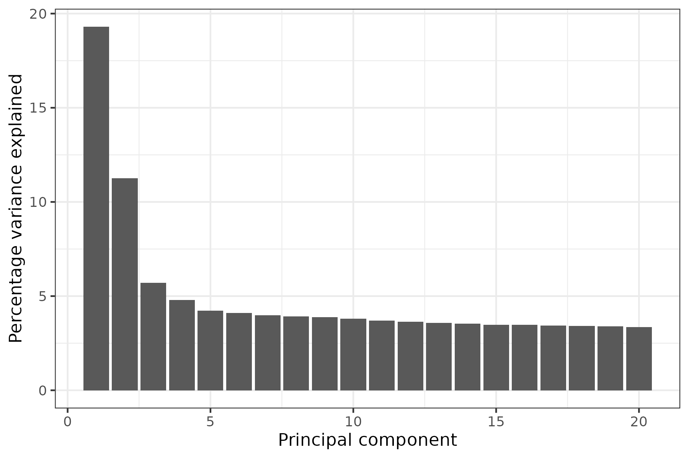
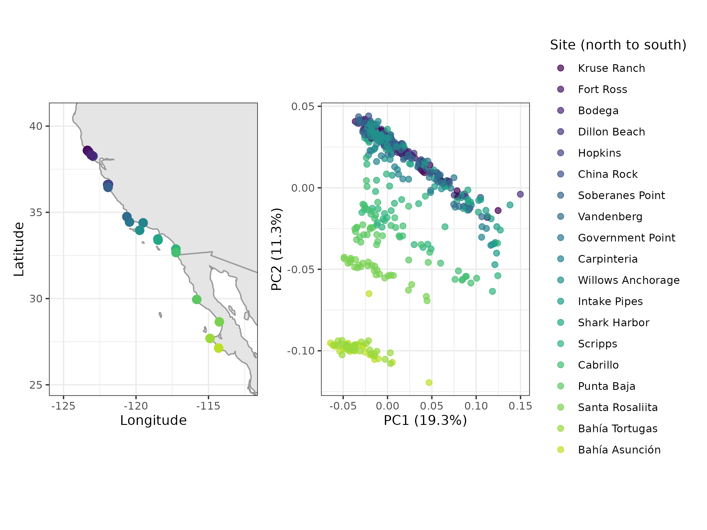
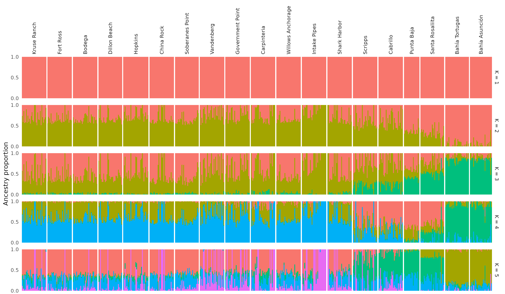
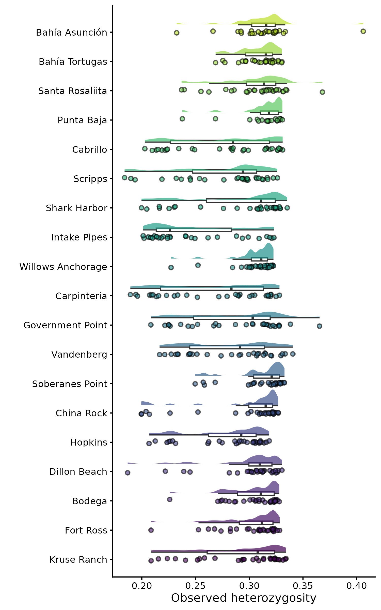
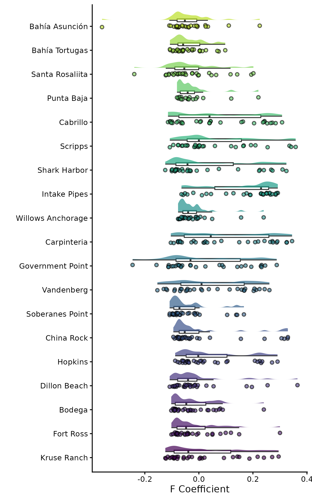

# Population Genomics Notebook

**Course:** Intro to Ecological Genomics - Fall 2026

**Name:** Anna Smith

------------------------------------------------------------------------

## 10/13/2026 - Working with VCF files

-   Describe the main steps that take raw sequencing reads to a filtered VCF

-   Read the header, fixed columns and genotype fields of a VCF

-   Query a VCF with bcftools (header, samples, records and regions)

-   Calculate per-individual missingness and depth with vcftools

-   Write, submit and monitor a batch job on the VACC

**Working Directory**

`/gpfs1/home/a/s/asmit168/eco_genomics_2026/population_genomics`

**Input Files**

`none`

**Output Files**

`/gpfs1/home/a/s/asmit168/eco_genomics_2026/population_genomics/Population_Genomics_Notebook.md`

**Programs and dependencies:**

-   `R tidyverse 4.5.1`

-   `R-Studio`

-   `load ecogen-rlibs`

**Scripts:**

`none; all code run in terminal`

**Code:**

``` bash
#### What is a VCF? ####
# A VCF (Variant Call Format) file stores the positions in the genome where variants were found among our samples, along with every individual’s genotype at those positions. It has two parts:

# a header: lines starting with ## that record how the file was made and define every field used in it
# a body: one line per variant
# The full specification is at https://samtools.github.io/hts-specs/VCFv4.2.pdf.

## Pipeline ##

# raw sequences (.fastq)
# Quality Control (QC, fastp)
# Alignment/mapping (bwa)
# Mapping Quality (picard)
# variant calling (samtools/bcftools)
# SNP filtering (bcftools)

#### From reads to alignments ####
# 1. Quality control and trimming. Raw reads arrive from the sequencer as FASTQ files. We check read quality with FastQC (MultiQC combines many FastQC reports into one), then remove adapters and trim low-quality bases with a trimmer such as fastp (fastp also does the same as FastQC, but it is sometimes good to do both!).
# 2. Mapping. The cleaned reads are mapped to the reference genome (or assembled de novo if there is no reference). We used BWA (the Burrows–Wheeler Aligner), which indexes the reference using the Burrows–Wheeler transform so it can work out where millions of short reads belong quickly and with little memory.
# 3. Cleaning up the alignments. We then remove reads that would bias the variant calls, for example PCR duplicates (identical copies of the same DNA fragment made during library amplification) and reads that map poorly.

# mapping = approximate, alignment = exact #

#### CODING DONE IN BASH ####
 # copy over 4 files from /gpfs1/cl/biol3990/PopulationGenomics/VCF to /gpfs1/home/a/s/asmit168/eco_genomics_2026/population_genomics/mydata

# run zcat Lottia_gigantea_biallelic.vcf.gz | head -n 20 
  # There is one ##contig line for every sequence in the reference genome. Our reference, the owl limpet (Lottia gigantea) assembly, is scaffold-level: roughly 360 Mb split into thousands of scaffolds with no assembled chromosomes (4469 to be precise), so the header contains thousands of these lines.
  # A contig is a continuous stretch of DNA sequence assembled from overlapping reads, with no gaps. Contigs are ordered and joined into scaffolds (which can contain gaps of unknown sequence, written as Ns), and in the best assemblies scaffolds are placed onto chromosomes. How far an assembly gets depends on its quality. The VCF header calls every reference sequence a “contig”, whichever of these it actually is.

#### Reading the header with bcftools ####
  # A better way to look at a VCF is with our first tool, bcftools. Load it on the VACC first, and always record which version you are using:
module load gcc
module load bcftools

bcftools --version   # bcftools 1.19, Using htslib 1.19.1 (ALWAYS RECORD VERSIONS)
bcftools -h          # -h or --help usually gets you the manual

bcftools head Lottia_gigantea_biallelic.vcf.gz

# Again we get a big string of contig lines. Let’s pipe (|) the output into grep to remove them:
bcftools head Lottia_gigantea_biallelic.vcf.gz | grep -v "##contig="
  # grep (“global regular expression print”) searches text for a pattern and prints the lines that match. The -v option inverts this, printing only the lines that don’t match.

# Better. Now you can see how the file was made and what each field means. Each ##INFO and ##FORMAT line defines one of the tags used in the body of the file:
bcftools view -h Lottia_gigantea_biallelic.vcf.gz | grep "^##INFO"
bcftools view -h Lottia_gigantea_biallelic.vcf.gz | grep "^##FORMAT"

# bcftools also writes every command it runs into the header (in lines containing Command=), so you can often reconstruct how a file was made and filtered:
bcftools view -h Lottia_gigantea_biallelic.vcf.gz | grep "Command="

#### Reading a variant record ####
  # Let’s look at the first few SNPs to see what our data look like. The -H option drops the header so we only see variant records:
  
# View the first SNP
bcftools view -H Lottia_gigantea_biallelic.vcf.gz | head -n 1

# the first 5 records; less -S stops long lines wrapping (press q to exit)
bcftools view -H Lottia_gigantea_biallelic.vcf.gz | head -n 5 | less -S
```

**Filtering The VCF**

| Filter | Threshold | Why |
|-------------------|-------------------|----------------------------------|
| Variant type | Biallelic SNPs only | Indels and sites with more than two alleles are harder to call reliably, and many are sequencing errors |
| Site Quality (QUAL) | ≥ 30 | A Phred score of 30 means a 1 in 1,000 chance that the call is wrong |
| Genotype Depth | ≥ 3 reads | Genotypes supported by very few reads are unreliable, so they are set to missing |
| Missingness | Remove sites missing in \> 30% of individuals | Sites with lots of missing data add noise and can bias downstream analyses |
| Minor Allele Frequency (MAF) | Commonly 1% or 5% | Very rare alleles are hard to distinguish from sequencing errors; 5% is the stricter cut-off |

------------------------------------------------------------------------

## 10/15/2026 - Working with VCF files

-   Describe the main steps that take raw sequencing reads to a filtered VCF

-   Read the header, fixed columns and genotype fields of a VCF Query a VCF with bcftools (header, samples, records and regions)

-   Calculate per-individual missingness and depth with vcftools

-   Write, submit and monitor a batch job on the VACC

**Working Directory**

`/gpfs1/home/a/s/asmit168/eco_genomics_2026/population_genomics`

**Input Files**

`none`

**Output Files**

`/gpfs1/home/a/s/asmit168/eco_genomics_2026/population_genomics/myscripts/Batch1.sh`

**Programs and dependencies:**

-   `R version 4.5.1`

-   `R-Studio`

-   `load ecogen-rlibs`

**Scripts:**

`none; all code run in terminal`

**Code:**

``` bash
# Where did we get the data
  # SRA - sequence read archive

#### fixing wrong data from tuesday ####
# delete previous data from tuesday
# cp (4 data) ~/eco_genomics_2026/population_genomics/mydata

#### working in terminal with VCF data ####
module purge
module load gcc
module load bcftools
module load vcftools

bcftools --version   # bcftools 1.19 Using htslib 1.19.1
bcftools -h          # -h or --help usually gets you the manual

bcftools head Lottia_gigantea_biallelic.vcf.gz

## Query tool ##

# bcftools query -f prints only the fields you ask for, which is how we will get data out of a VCF and into other programs. Fields are written as %NAME, \t is a tab, \n is a new line, and anything in square brackets is repeated for every sample:

# scaffold, position, alleles and every individual's genotype for the first 5 SNPs
bcftools query -f '%CHROM\t%POS\t%REF\t%ALT[\t%GT]\n' \
    Lottia_gigantea_p1_flt3.renamed.vcf.gz | head -n 5

#### Running a Batch Job ####
# type nano in terminal to get text editor
  # gets you more memory so does stuff fast
  # first lines tell computer specifics of job and where it is stored, partition will always be general (big computer), how many nodes are needed (always 1 node), cpu per task may change depending on data size (1 should be fine), CHANGE MEMORY DEPENDING ON DATA (small task = less than 5 gigs of data), time should change depending on analysis, output and error stay same, mail type emails when job starts and ends, TEMPLATE BELOW to use every time, 
```

**BATCH TEMPLATE**

#!/bin/bash

#SBATCH --job-name=vcf_stats

#SBATCH --partition=general #SBATCH --nodes=1

#SBATCH --cpus-per-task=1 #SBATCH --mem=40G

#SBATCH --time=30:00:00 #SBATCH --output=./logs/%x.%j.out

#SBATCH --error=./logs/%x.%j.err

#SBATCH --mail-type=ALL

#SBATCH --[mail-user=NETID\@uvm.edu](mailto:mail-user=NETID@uvm.edu){.email}

------------------------------------------------------------------------

## 10/20/2026 - Population Structure

-   explain what linkage disequilibrium (LD) is and why we prune it before looking at population structure

-   LD-prune a VCF with plink

-   run a principal component analysis (PCA) with plink and plot it in R

-   run ADMIXTURE across a range of K and use cross-validation to choose which values to look at

-   interpret PCA and ADMIXTURE plots, and recognise their common pitfalls

**Working Directory**

`/gpfs1/home/a/s/asmit168/eco_genomics_2026/population_genomics`

**Input Files**

`none`

**Output Files**

**Programs and dependencies:**

-   `R tidyverse 4.5.1`

-   `R-Studio`

-   `load ecogen-rlibs`

**Scripts:**

`PCA_10_20_26.R in myscripts`

**Code:**

``` bash
#### Setting Up ####
# First, make a folder for today’s work and move into it.

# Then store the location of the VCF in a variable, so we don’t have to type the full path every time:
mkdir -p ~/eco_genomics_2026/population_genomics/mydata/Population_Structure 

# where the VCF lives (make sure this is the right path!)

## REMEMBER: you need to run this every time you open a VACC session as it does not save this variable ##

DATA_DIR=~/eco_genomics_2026/population_genomics/mydata
VCF=$DATA_DIR/Lottia_gigantea_pl_flt3.renamed.vcf.gz

# check the variable holds what you expect, and that the file is really there
echo $VCF
ls -lh $VCF

cd $DATA_DIR
pwd ##check you are in the right place

# within Population_Structure in mydata, I have all of PCA, admixture, and metadata files stored #

#### Pruning with Plink ####
# Load plink and check the version. We need PLINK 1.9: PLINK 2.0 (plink2) changed a lot of the syntax, and not all of the commands below will work with it.
module load plink
plink --version   # PLINK v1.9.0-b.7.7 64-bit (22 Oct 2024)

# created for human genomics, so our data is lacking in comparison, therefore we need to format our data in a way that plink will be able to read
#The \ at the end of a line tells bash that the command continues on the next line. It must be the very last character on the line, with no spaces after it.

#Let’s run through what we asked plink to do. plink --help lists every option, and plink --help indep-pairwise gives the manual for just one.
plink --vcf $VCF --double-id --allow-extra-chr \
    --set-missing-var-ids @:# \
    --indep-pairwise 50 10 0.2 \
    --out Lg_LD_0.2
# how many SNPs did we keep and remove?
wc -l Lg_LD_0.2.prune.in Lg_LD_0.2.prune.out
  # 549850 Lg_LD_0.2.prune.in
  # 1271900 Lg_LD_0.2.prune.out
  # 1821750 total
#### Plink output Files ####
# File                       Contents
# Lg_LD_0.2.prune.in      -      IDs of the SNPs to keep (LD pruned data)
# Lg_LD_0.2.prune.out     -      IDs of the SNPs to remove (SNPs in LD > 0.2)
# Lg_LD_0.2.log         -      Everything plink printed to the screen. Check here how many SNPs and samples were read in
# Lg_LD_0.2.nosex         -      The samples with no sex information, which is all of ours. plink expects sexes for human data, so you can ignore this file

#### RUNNING PCA ####
# Now we run the PCA on just the SNPs we kept:
plink --vcf $VCF --double-id --allow-extra-chr --set-missing-var-ids @:# \
    --extract Lg_LD_0.2.prune.in \
    --make-bed --pca --out Lg_LD_0.2
## Output Files ##
# Lg_LD_0.2.eigenvec == The PCA results: one row per individual, with its family ID, individual ID, then its score on PC1 to PC20
# Lg_LD_0.2.eigenval    ==  The eigenvalue of each PC: how much of the variation it captures
# Lg_LD_0.2.bed ==  The genotypes of the pruned SNPs, stored in a compressed binary format. You can’t read it as text, and it isn’t the same thing as a BED file of genome intervals!
# Lg_LD_0.2.bim  ==  One row per SNP: scaffold, SNP ID, genetic distance (0 = unknown), position, and the two alleles
# Lg_LD_0.2.fam  ==  One row per individual: family ID, individual ID, father, mother, sex and phenotype (0 or -9 = unknown)

# Each row of the .eigenvec file holds an individual’s eigenvector values, i.e. its coordinates on each PC, which are what we plot. The eigenvalues tell us how much of the variation each PC captures. Take a quick look:
# first 3 individuals, first 4 PCs (cut -f keeps only the columns we ask for)
head -n 3 Lg_LD_0.2.eigenvec | cut -d " " -f 1-6
cat Lg_LD_0.2.eigenval

#### Plotting the PCA in R ####
# all code done in PCA_10_20_26.R in myscripts

#### ADMIXTURE ####
  
  # we did not actually run this ourselves as it would take forever and crash and bad things would happen?
  
  # we should expect 1-5 K values based on the data and thoughts on PCA
  
  # K=3 results in the smallest error value (best describes data accurately)
  
  # double carrot >> appends/adds rather than overwrites it 
  
  
```

**pve scree plot**



-   Full set not subset of data

-   how many PCs should we actually look at to describe population structure?

-   PCs beyond 3-4 are likely noise/don't look at them (1 and 2 most important)

**PCA Plot**


-   two most southern populations distinctly diverged from the rest, and it scales as a gradient across latitudes

    **Latitudinal PCA**

    

-   Both PCs are strongly correlated by latitude, PC2 likely better explanation of latitude gradient due to tighter clustering.

-   strong effect of latitude on population structure

    **Map Plot vs. PCA**

    

**CV Plot**


-   K = 3 looks best as it has the lowest cross-validation error

-   when you make these plots, make sure you see it going down and back up again to make sure you did get the lowest error K value

    **Admixture Plot**

    

-   how all of the different K values assign each locality/population structure among localities

-   k=3 we again see the last/southernmost as "outliers" or distinct, not super clean but neither was the PCA

    **Takeaway from the Day**: likely 3 populations of limpet best describes population structure

------------------------------------------------------------------------

## 10/22/2026 - Genetic Diversity

-   explain what nucleotide diversity (π), Tajima’s D and heterozygosity measure, and what can bias them

-   calculate π and Tajima’s D in windows along the genome with vcftools, for all samples together and for each population

-   estimate each individual’s heterozygosity and inbreeding coefficient (F)

-   compare diversity among populations and along the genome in R

**Working Directory**

`/gpfs1/home/a/s/asmit168/eco_genomics_2026/population_genomics`

**Input Files**

`none`

**Output Files**

**Programs and dependencies:**

-   `R tidyverse 4.5.1`

-   `R-Studio`

-   `load ecogen-rlibs`

**Scripts:**

Genetic_Diversity_10_22_26.R

**Code:**

``` bash
#### Setting Up ####
    #Point to the folder for today’s work and point the programme to   your VCF, for coding along, use the randomly subsetted VCF. We can also make a new directory within my results.

cd ~/eco_genomics_2026/population_genomics/mydata

module load vcftools
vcftools --version   # UNKNOWN... module list = vcftools/0.1.16

# the 1% subset from Class 1 (make sure this is the right path!)
# We will assign our data directory and VCF now so we dont have to move around to find this. We will now call #$VCF when needed
DATA_DIR=/users/a/s/asmit168/eco_genomics_2026/population_genomics/mydata/Genetic_Diversity 
VCF=$DATA_DIR/Lottia_gigantea_pl_flt3_noMAF_sub0.01.vcf.gz

#### A Population Map ####
    # vcftools calculates statistics for whichever individuals we give it with --keep, which takes a file with one sample ID per line. To get statistics for each population, we need one of these files per population

#First, make a population map from the metadata, with two tab-separated columns: the sample ID and its site.

# check which columns hold the sample ID and the site
head sample_metadata.csv

# skip the header line (tail -n +2), keep columns 1 and 2 (cut),
# and swap the comma between them for a tab (tr)
tail -n +2 sample_metadata.csv | cut -d ',' -f 1,2 | tr ',' '\t' > popmap.txt
head popmap.txt ##check it looks correct

## Danny prepped all of the data folders (het, pi, pops, TajD) in BASH, explination on day 4 coding tutorial ##

#### Coding in Genetic_Diversity_10_22_26.R ####


```

**Pi Plot**


-   violin plot with a boxplot within, log10 scale for visuals

-   INT population stands out to me as it has a lower nucleotide diversity than the rest of the populations (why?)

-   Hard to distinguish patterns generally

------------------------------------------------------------------------

## 10/27/2026 - Genetic Diversity Day 2

-   explain what nucleotide diversity (π), Tajima’s D and heterozygosity measure, and what can bias them

-   calculate π and Tajima’s D in windows along the genome with vcftools, for all samples together and for each population

-   estimate each individual’s heterozygosity and inbreeding coefficient (F)

-   compare diversity among populations and along the genome in R

**Working Directory**

`/gpfs1/home/a/s/asmit168/eco_genomics_2026/population_genomics`

**Input Files**

`none`

**Output Files**

figures in myresults/Genetic_Diversity

**Programs and dependencies:**

-   `R tidyverse 4.5.1`

-   `R-Studio`

-   `load ecogen-rlibs`

**Scripts:**

Genetic_Diversity_10_22_26.R

**Code:**

``` bash
#### Coding in Genetic_Diversity_10_22_26.R ####
# picking up at end of script for day 2 of same day 4 coding tutorial

#### Heterozygosity ####

#Observed heterozygosity (HO) is the proportion of sites at which an individual is heterozygous.

#Expected heterozygosity (HE) is the proportion we would expect if the population mated at random (Hardy–Weinberg equilibrium): 2pq at each site, where p and q are the allele frequencies.

#The inbreeding coefficient compares the two: F = 1 − HO / HE. F = 0 means an individual is as heterozygous as expected, F > 0 means less heterozygous, and F < 0 means more.

## F coeff ##

#F  Possible causes
#Positive (too few heterozygotes)   
  #Inbreeding (mating between relatives); genotyping errors, especially at low   coverage, where heterozygotes are miscalled as homozygotes

#Negative (too many heterozygotes)  
  #Mating between divergent populations; mapping errors, where reads from duplicated regions (paralogs) pile up on one locus and look like heterozygotes in everyone
```

**Pi Lat Plot**


**Scan Plot**


-   int is probably sequencing error or a site of extremly low diversity, should look into it to understand further.

-   if everything was neutral, everything would fix or dispensary. sites of diversity and consistent diversity means something is keeping equilibrium, preventing a sweep or extinction, so they are points of interest in the genome. Could be conditionally beneficial in different environments (balancing selection).

**Taj D Plot**


-   most southern sites = higher temp = driving selection, but overall everything is fairly uniform looking.

**Heterozygosity by Site Raincloud Plot**

{width="1200"}

-   difficult to pick up on patterns, besides intake having a lower He than everything else (like scan plot)

-   higher He at ends, lower at center ranges

-   some locations have all individuals with the same/tightly clustered He, while others are have individuals with evenly spread He values.

**Inbreeding coeff (F) Plot**



-   Intake has high F coeff = excess of inbreeding

------------------------------------------------------------------------

## 10/27/2026 - Signatures of Selection

-   Explain what is meant by a signature of selection, and why genome scans look for outliers against a neutral genomic background

-   Calculate genome-wide and windowed pairwise FST with vcftools, and plot an FST genome scan in R

**Working Directory**

`/gpfs1/home/a/s/asmit168/eco_genomics_2026/population_genomics`

**Input Files**

`none`

**Output Files**

**Programs and dependencies:**

-   `R tidyverse 4.5.1`

-   `R-Studio`

-   `load ecogen-rlibs`

**Scripts:**

Signature_of_selection_10_27_26.R in myscripts

**Code:**

``` bash
# Using Genetic Diversity for location of data, working in the terminal to get things set up before we code in R
# set directory = DIR 
DIR=/gpfs1/home/a/s/asmit168/eco_genomics_2026/population_genomics/mydata/Genetic_Diversity
# copy pop_level_biooracle to mydata
cp /gpfs1/cl/biol3990/PopulationGenomics/Selection/pop_level_biooracle.csv $DIR
# It is worth checking that the sample IDs in the popmap match the IDs in the VCF exactly (capitals, underscores and any suffixes all matter), sometimes the IDs can end up with extra stuff e.g., filepaths.

# sample IDs from the VCF header line (#CHROM ...), one per line
zgrep -m 1 "^#CHROM" Lottia_gigantea_flt3_sub0.01.vcf.gz | cut -f 10- | tr '\t' '\n' > vcf_samples.txt
wc -l vcf_samples.txt #should be 553 YEP
head vcf_samples.txt # is it as expected? IDK, it printed ASU 01 thru 10 

# As with last section, vcftools needs a separate text file for each population that lists the IDs of the individuals in it, one per line. You should have these saved in pops from the genetic diversity class, if not, the code is below:

mkdir -p pops

for pop in $(cut -f2 popmap.txt | sort -u); do
  awk -F '\t' -v p="${pop}" '$2 == p {print $1}' popmap.txt > pops/${pop}.txt
done

ls pops/ # ASU.txt  CAB.txt  CHI.txt  GOV.txt  INT.txt  PUN.txt  SAN.txt  SHA.txt  TOR.txt  WIL.txt BOD.txt  CAR.txt  DIL.txt  HOP.txt  KRU.txt  ROS.txt  SCR.txt  SOB.txt  VAN.txt

#### FST GENOME SCAN ####
    #An important measure of population divergence is FST (the fixation index). FST asks how much of the total genetic variation is due to differences between populations.
    #FST ranges from 0 (no genetic differentiation between the populations, i.e., panmixia) to 1 (complete fixation, i.e. very genetically divergent populations).


#### Genome-wide FST between two populations ####


# We start with two populations, lets use two populations we think may be quite diverged based on the PCA and Admixture evidence; the most southern and the most northern sites Bahía Asunción (ASU) and Kruse Ranch (KRU).

# the further apart two populations, the larger the FST as they are more diverged from one another compared to if they were closer together (isolation by distance)
##first make sure you are in the right directory
## should be </users/d/s/dsadler1/projects/eco_genomics_2026/PopulationGenomics/mydata>
cd $DIR

###load vcftools
module load gcc # gcc (Spack GCC) 13.3.0
module load vcftools # # UNKNOWN... module list = vcftools/0.1.16

###lets do the usual assigning of VCF:
VCF=$DIR/Lottia_gigantea_flt3_sub0.01.vcf.gz
POP1=ASU     # This can be any population, but lets do most southern ...
POP2=KRU     # ... and most northern.

mkdir -p fst #lets make a FST directory 

###Ok now lets run vcftools 
vcftools --gzvcf ${VCF} \
  --weir-fst-pop pops/${POP1}.txt \
  --weir-fst-pop pops/${POP2}.txt \
  --out fst/${POP1}_vs_${POP2} \
  2> fst/${POP1}_vs_${POP2}.log ##prints what would be displayed in the terminal to summarise mean FST

grep "Fst estimate" fst/${POP1}_vs_${POP2}.log
  # Outputting Weir and Cockerham Fst estimates:
  #Weir and Cockerham mean Fst estimate: 0.016245
  #Weir and Cockerham weighted Fst estimate: 0.020162
head fst/${POP1}_vs_${POP2}.weir.fst

# The log reports two genome-wide estimates:
  # Mean FST: the average of the per-SNP FST values.
  # Weighted FST: the variance among populations summed across all SNPs, divided by the total variance summed across all loci. This is the better genome-wide estimate to use as it has corrected for sample size.
  #The .weir.fst file has one line per SNP, with the columns CHROM (chromosome), POS (position) and WEIR_AND_COCKERHAM_FST (FST value).
  
  
#### Genome-wide FST between all pairs of populations ####


# A loop calculates the genome-wide FST for every pair and collects the results in one table. Dont worry about the complexities of the code too much, this is pulled from other work, and is just an efficient way to run through many of the contrasts.

POPS=( $(cut -f2 popmap.txt | sort -u) ) ##f extracts column, 2 extracts second column, sort -u keeps only unique values (i.e., gives you one row per pop)
mkdir -p fst/pairwise
echo -e "pop1\tpop2\tmean_fst\tweighted_fst" > fst/pairwise_fst_summary.txt #makes empty txt file headed as pop1 etc

for (( i=0; i<${#POPS[@]}; i++ )); do
  for (( j=i+1; j<${#POPS[@]}; j++ )); do
    p1=${POPS[$i]}
    p2=${POPS[$j]}
    vcftools --gzvcf ${VCF} \
      --weir-fst-pop pops/${p1}.txt \
      --weir-fst-pop pops/${p2}.txt \
      --out fst/pairwise/${p1}_vs_${p2} \
      2> fst/pairwise/${p1}_vs_${p2}.log
    mean=$(grep "mean Fst" fst/pairwise/${p1}_vs_${p2}.log | awk '{print $NF}')
    weighted=$(grep "weighted Fst" fst/pairwise/${p1}_vs_${p2}.log | awk '{print $NF}')
    echo -e "${p1}\t${p2}\t${mean}\t${weighted}" >> fst/pairwise_fst_summary.txt
  done
done


column -t fst/pairwise_fst_summary.txt


# SWITCH TO LOOKING AT RESULTS IN R #


# all coding done in script Signature_of_selection_10_27_26.R 
```
